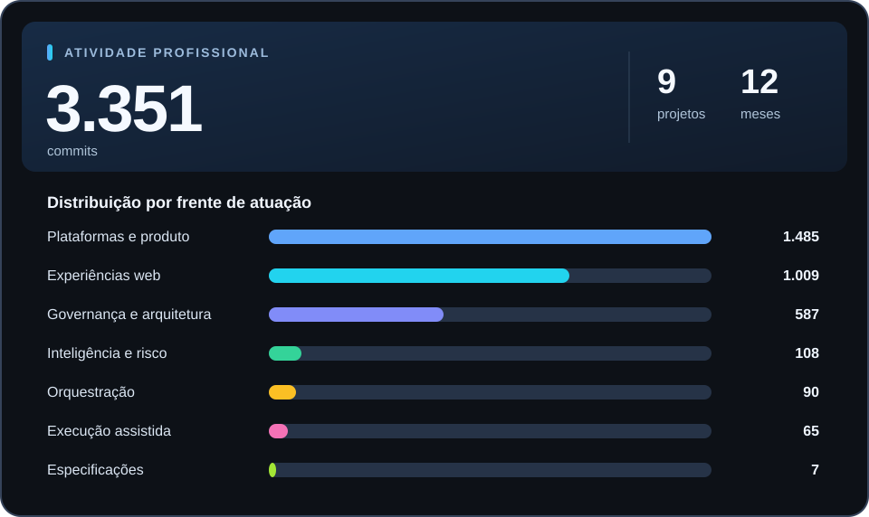

# Victor Braga

**Produto · Tecnologia · IA aplicada**

Transformo discovery, arquitetura e contexto de negócio em soluções digitais e entregas mensuráveis.

  
  
  
  

---

## O que eu faço

- **Discovery de produto e tecnologia:** mapeamento de oportunidades, capacidades, integrações, riscos e viabilidade.
- **IA aplicada e automação:** copilots operacionais, ferramentas de análise e fluxos de desenvolvimento assistido.
- **Arquitetura e governança:** contratos técnicos, execução orientada a escopo, rastreabilidade e validação.
- **Experiências digitais:** interfaces web, visualização de dados e interações orientadas à experiência.

## Tecnologias e ferramentas

  
   
  

  Também trabalho com GSAP, Playwright, APIs, LLMs e automação de fluxos.

## Atividade Profissional

## Projetos públicos em destaque

<table>
  <tr>
    <td width="33%" valign="top">
      <strong><a href="https://github.com/victorbraga8/niteroi-fc">Niteroiense FC</a></strong>
      
Experiência digital esportiva, com cenas animadas, conteúdo estruturado e testes de responsividade.

      Astro · TypeScript · GSAP · Three.js
    </td>
    <td width="33%" valign="top">
      <strong><a href="https://github.com/victorbraga8/sigeo">SIGEO</a></strong>
      
Aplicação geoespacial com mapas interativos, integração de dados e componentes de gestão.

      Next.js · ArcGIS · GeoJSON · PostgreSQL
    </td>
    <td width="33%" valign="top">
      <strong><a href="https://github.com/victorbraga8/lancer-performance">Lancer Performance</a></strong>
      
Experimento de storytelling visual com sequências cinematográficas orientadas por scroll.

      React · Three.js · Motion
    </td>
  </tr>
</table>

Produto, engenharia e experimentação como partes do mesmo processo de entrega.

